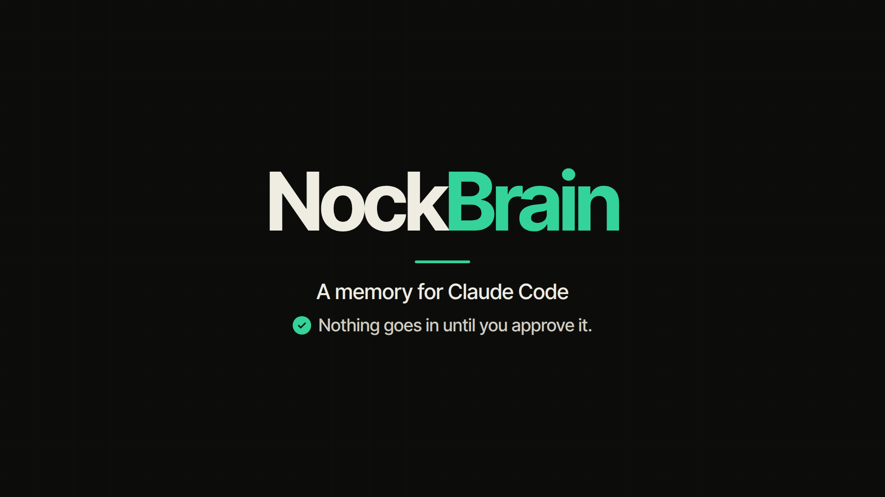

# NockBrain

I built this because I was tired of explaining my own decisions to Claude Code again every few sessions, and I didn't trust a memory that writes itself. NockBrain keeps a small, signed store of facts you've reviewed, on your own machine. When a prompt asks about the past, it hands the matching facts back to Claude as reference. Nothing goes in until you've read it and applied it.

<picture>
  <source media="(prefers-color-scheme: dark)" srcset="docs/diagrams/how-it-works-dark.svg">
  
</picture>

[](media/nockbrain-explainer.mp4)

The one-minute explainer, its captions and the script behind it are in [media/](media/).

## Who it's for

NockBrain fits one person who works with Claude Code across many sessions and is tired of explaining the same decisions, rules and corrections again. It runs on macOS and Linux, and the stock macOS `python3` is enough. Claude Code gets automatic capture and recall; Codex CLI, Gemini CLI, Cursor and Claude Desktop can recall through the MCP server. If you want a memory that fills itself with no review step, this is the wrong tool.

## How it works

You decide what goes in. Point NockBrain at notes you choose, or turn on an optional Claude Code hook that queues what was said in a session each time Claude finishes a reply. Either way the candidates land in a review queue with secrets redacted, and nothing is in memory yet. You read every candidate with its kind and the line it came from, then apply the batch or discard it. Applied facts are signed, and their signed content is never rewritten.

Recall is opt-in too. When a prompt asks about the past, the hook verifies every signature in the store first and adds nothing if any check fails. Then it ranks your current facts by shared words and returns up to 800 tokens of them, labeled as untrusted reference so Claude treats them as data.

When a fact goes stale you correct it or forget it, and both go through the same review. A correction keeps the old record as history. Forgetting removes the record and leaves a signed revocation with no content in it, so applying the same fact again skips it.

The long version, with the line of code behind each claim, is in [docs/how-it-works.md](docs/how-it-works.md).

## Quick start

You need Python 3.9 or newer on macOS or Linux. There's nothing to install, because NockBrain uses only the standard library. If the `cryptography` package is already installed, new stores sign with Ed25519; without it they use HMAC-SHA256.

Clone it somewhere you'll keep it. The hook settings you generate later point at this folder.

```sh
git clone https://github.com/nocktechnologies/nockbrain.git
cd nockbrain
STORE="$HOME/nockbrain-store"
python3 bin/consumer-brain.py init --store "$STORE"
python3 bin/consumer-brain.py propose --store "$STORE" --format markdown --source "$PWD/examples/notes.md"
```

The store path has to be new, and its parent has to exist. `propose` prints a digest and the exact review command. Read the whole review before you apply it.

```sh
python3 bin/consumer-brain.py review --store "$STORE" --proposal FULL_DIGEST
python3 bin/consumer-brain.py apply  --store "$STORE" --proposal FULL_DIGEST
python3 bin/consumer-brain.py open   --store "$STORE"
```

`open` starts Memory Explorer, a read-only page on 127.0.0.1, and opens it in your browser. Ctrl-C stops it.

## Use it inside Claude Code

```sh
python3 bin/consumer-brain.py setup-hooks --store "$STORE" \
  --transcript-root "$HOME/.claude/projects/YOUR-PROJECT-FOLDER"
claude --settings "$STORE/claude-settings.json"
```

Claude Code keeps transcripts under `~/.claude/projects/`, one folder per project. Allow only the project you want. Sessions you launch with that settings file get both hooks. When Claude finishes a reply, the capture hook queues any new candidates for your review and never applies them. When you ask about the past, the recall hook adds what matches. Launch Claude Code without the settings file and NockBrain stays out of the session.

## Let Claude run it for you

```sh
claude --append-system-prompt-file "$PWD/docs/agent-playbook.md" \
  "Use this checkout and the NockBrain store at $STORE. Check its status and help me manage memories."
```

The playbook teaches Claude the same commands, so you can say "remember this exact decision" and later correct or forget it in plain language. It guides the agent. Claude Code's normal permission prompts still apply.

## Use it with other agents

NockBrain ships a read-only MCP server, so any MCP client can recall from your store. For Codex CLI:

```sh
codex mcp add nockbrain -- python3 "$PWD/bin/nockbrain-mcp.py" --store "$STORE"
```

The server has two tools, `recall` and `status`, and nothing that writes. Recall runs the same verified path as the Claude Code hook and returns the same 800-token budget, labeled as untrusted reference. Capture is still Claude Code only, so facts from other agents come in through a notes file and `propose`. [docs/mcp.md](docs/mcp.md) has the setup for Claude Code, Codex CLI, Gemini CLI, Cursor and Claude Desktop.

## Privacy

NockBrain makes no network calls, no model calls and sends no telemetry. It reads only the files you name and, if you turn the hook on, only the transcript Claude Code hands it from a folder you allowed. Your store is a folder only your user can open. Claude Code's own conversation with Claude still leaves your machine as it always does, and it carries any facts the hook adds. [docs/privacy-and-security.md](docs/privacy-and-security.md) covers what's refused, how the store is signed and how to back it up.

## Limits

Recall matches words. A fact phrased differently from your question won't come back, because this release has no semantic search. It's built for one person and one store, with no installer and no Windows support. Automatic capture works with Claude Code only. Forgetting removes the exact record you pick; paraphrases in other records, your original notes and your backups stay yours to clean up.

## Documentation

| Doc | What's in it |
|---|---|
| [Getting started](docs/getting-started.md) | Your first store, your first review, turning on the hooks, daily use |
| [How it works](docs/how-it-works.md) | Capture, review, the signed store and recall, with diagrams and code references |
| [Privacy and security](docs/privacy-and-security.md) | What it reads, what it refuses, what it stores, how the store protects itself |
| [Commands](docs/commands.md) | Every command, flag and limit |
| [Agent playbook](docs/agent-playbook.md) | The guide you load into Claude so it runs NockBrain for you |
| [MCP server](docs/mcp.md) | Recall from Codex CLI, Gemini CLI, Cursor, Claude Desktop and Claude Code |
| [Memory Explorer](docs/memory-explorer.md) | The read-only browser view and its recall preview |
| [FAQ](docs/faq.md) | Short answers to the questions people ask first |

## License

MIT. Copyright 2026 Nock Technologies. See [LICENSE](LICENSE).

## Contributing

Bug reports and pull requests are welcome; [CONTRIBUTING.md](CONTRIBUTING.md) explains how changes get in. Security problems go through [SECURITY.md](SECURITY.md), never a public issue. If NockBrain misses something you told it, open an issue with the question you asked and the fact you expected, and I'll look at why.
