# How it works

You shouldn't have to take a memory tool's word for anything, so every section below ends with the files that do the work. NockBrain has four parts: capture, review, a signed store and recall. Capture and review decide what goes in. The store shows any tampering. Recall decides what Claude sees.

<picture>
  <source media="(prefers-color-scheme: dark)" srcset="diagrams/how-it-works-dark.svg">
  
</picture>

## Capture

There are two ways in, and both stop at the review queue. The first is `propose`, which reads the exact files you pass on the command line: Markdown notes or Claude Code `.jsonl` transcripts. The second is the optional Stop hook, which runs each time Claude finishes a reply. It reads only that session's transcript, and only when the transcript sits inside a folder you allowed with `setup-hooks`. Each capture replaces the earlier pending proposal from the same session, so a long session leaves a single proposal in the queue.

Before anything is saved, text that matches common secret and token shapes is redacted. Pattern matching misses things, which is why the review step exists. Messages that mix your text with tool output are skipped, and assistant text can never carry the authority of a decision, directive or correction. Inputs have hard limits: 16 files, 8 MiB each and 32 MiB in total, and at most 1,000 candidates in one proposal. Going over any of those fails the whole proposal instead of saving part of it. A single candidate longer than 1,500 characters is skipped and counted in the stats.

Code: `bin/_consumer_import.py` (selection, refusals, transcript parsing), `bin/_scrub.py` (redaction), `bin/_consumer_hooks.py` `capture()` (the Stop hook path).

## Review

A proposal is a file named by the SHA-256 digest of its content. It's bound to your store's ID, its signing key and the store's current generation, which is a hash of the facts and the revocation log. If anything changes in the store after a proposal is made, the proposal goes stale and can't be applied. You propose again and review the new digest.

`review` only reads. `apply` takes the whole proposal or nothing, and it skips candidates that are already stored or were forgotten.

<picture>
  <source media="(prefers-color-scheme: dark)" srcset="diagrams/review-lifecycle-dark.svg">
  
</picture>

Code: `bin/_consumer_store.py` `apply_proposal()` (stale check, skip rules), `discard_proposal()`, `propose_correction()`, `propose_forget()`, `recover()`.

## The signed store

Each fact's ID is the SHA-256 of the store ID, its kind and its text, so the same fact always gets the same ID. On apply, each new fact is signed once, and its signed content never changes after that. A correction adds a signed replacement and marks the old record superseded. Forgetting removes the record and appends a signed revocation that holds only the ID. Revocations are numbered, and each line carries the hash of the line before it, so a missing or edited line breaks the chain.

Every command that opens the store checks all of it: every fact signature, the revocation chain, and the history, meaning nothing revoked is current and nothing forgotten has come back. If any check fails, commands refuse to run and recall adds nothing. [Privacy and security](privacy-and-security.md#how-the-store-protects-itself) has the full diagram.

Code: `bin/_consumer_store.py` (fact IDs, validation, journaled changes), `bin/_sign.py` (Ed25519 with an HMAC-SHA256 fallback), `bin/_revoke.py` (the chained revocation log).

## Recall

In a session launched with the settings file from `setup-hooks`, a classifier looks at each prompt and decides whether you're asking about the past. If you aren't, nothing happens.

<picture>
  <source media="(prefers-color-scheme: dark)" srcset="diagrams/recall-pipeline-dark.svg">
  
</picture>

If you are, the hook copies the store's public files to a private temporary folder and verifies that copy, so a store that changes mid-read can't slip through. It keeps current facts with a confidence of 0.7 or more and ranks them with Okapi BM25, the same keyword scoring search engines have used for decades, multiplied by each fact's confidence, a decay for its age and a few smaller adjustments (`bin/budget-recall.py:553-562`). When your question has three or more meaningful words, a fact has to share at least two of them. It takes at most four facts from any one date before it looks at more, trims each fact to 320 characters around the words that matched, and stops at 800 tokens. Claude receives the result under a label that marks it as untrusted historical context.

The hook has five seconds. If it runs out of time, finds no match or hits any verification failure, Claude carries on with nothing added.

Recall matches words, and that's the main limit of this release. Semantic search and graph expansion exist in the code and are switched off here, so a fact you phrase differently from your question won't come back. Writing notes with the words you'll use later helps.

Code: `bin/recall-classifier.py` (`PAST_PATTERNS`, `classify()`), `bin/_consumer_hooks.py` (verify then recall, `budget=800`, `semantic=False`), `bin/budget-recall.py` (BM25, confidence floor, date cap, excerpts, budget), `bin/consumer-hook.py` (time limits and the reference label).

## Where each number comes from

| Number | What it limits | Code |
|---|---|---|
| 800 tokens | Recall budget per prompt | `bin/_consumer_hooks.py:254` |
| 0.7 | Lowest confidence recall will use | `bin/budget-recall.py:40` |
| 4 per date | Facts taken from one date before others | `bin/budget-recall.py:61` |
| 320 characters | Excerpt length per recalled fact | `bin/budget-recall.py:705` |
| 5 s and 10 s | Time limits for the recall and capture hooks | `bin/_consumer_hooks.py:88` |
| 16 files, 8 MiB, 32 MiB | Files, size per file and total size per proposal | `bin/_consumer_store.py:53-54`, `bin/_consumer_import.py:22` |
| 1,000 candidates of 1,500 characters | Candidates per proposal and length of each | `bin/_consumer_store.py:55`, `bin/_consumer_import.py:157` |
| 100 proposals, 64 MiB | Review queue size | `bin/_consumer_store.py:38-39` |
